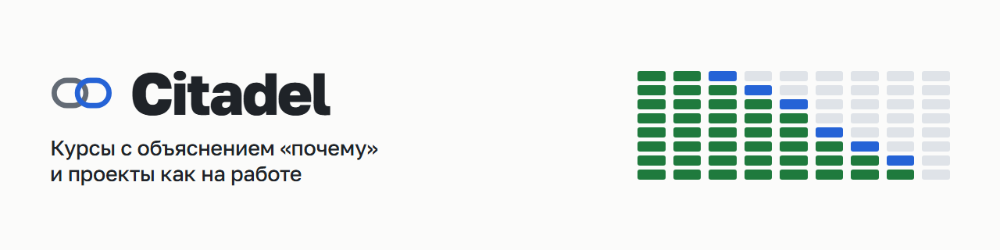
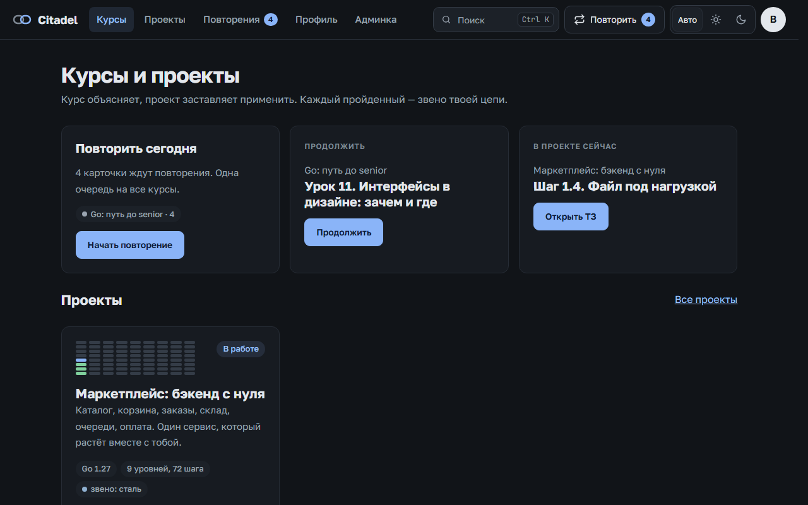
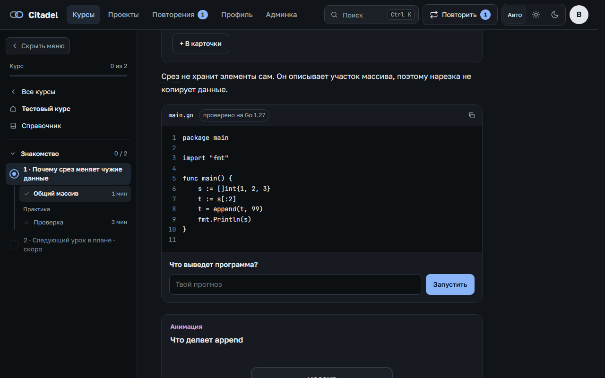
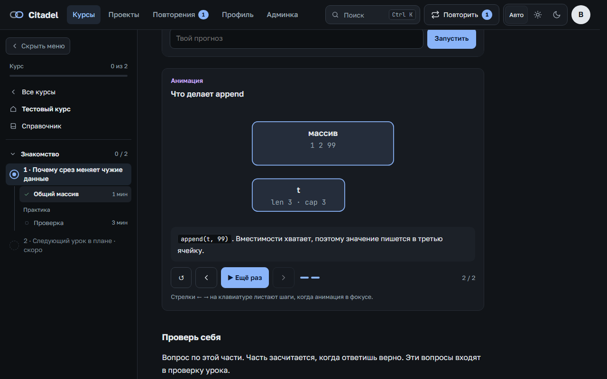
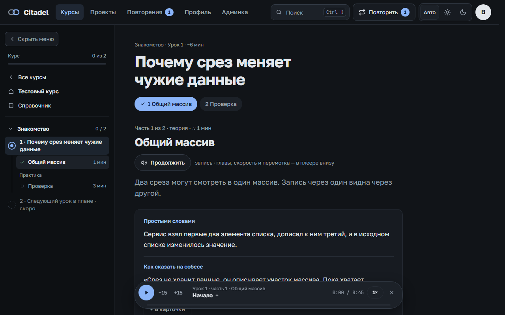
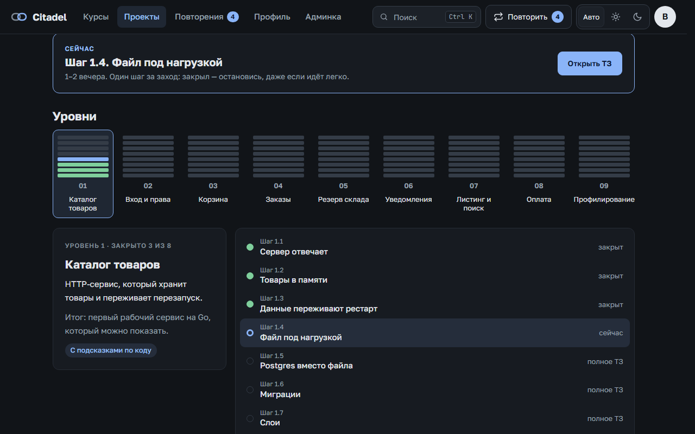
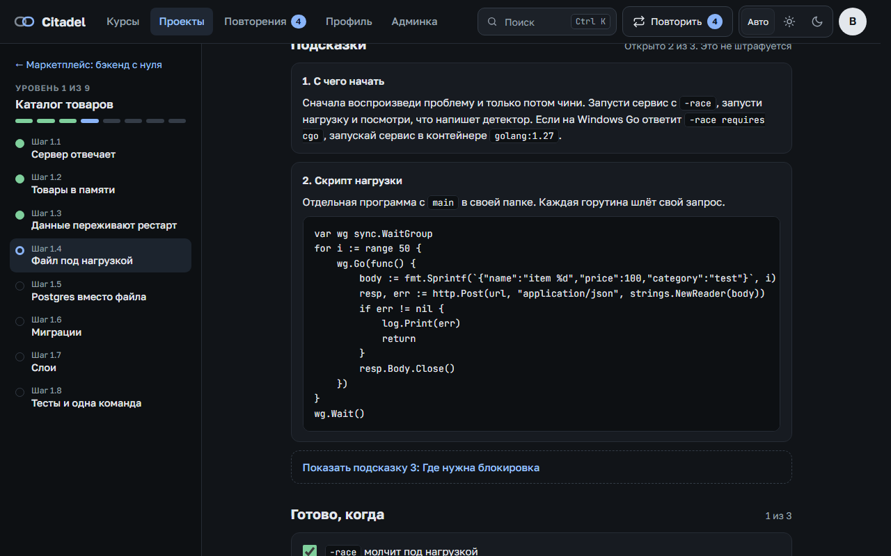
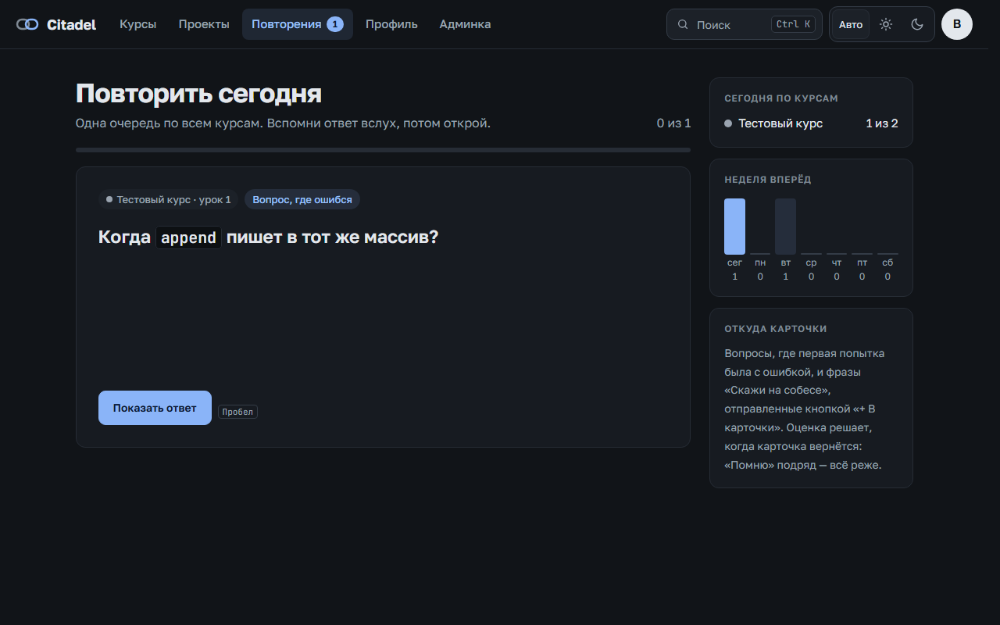
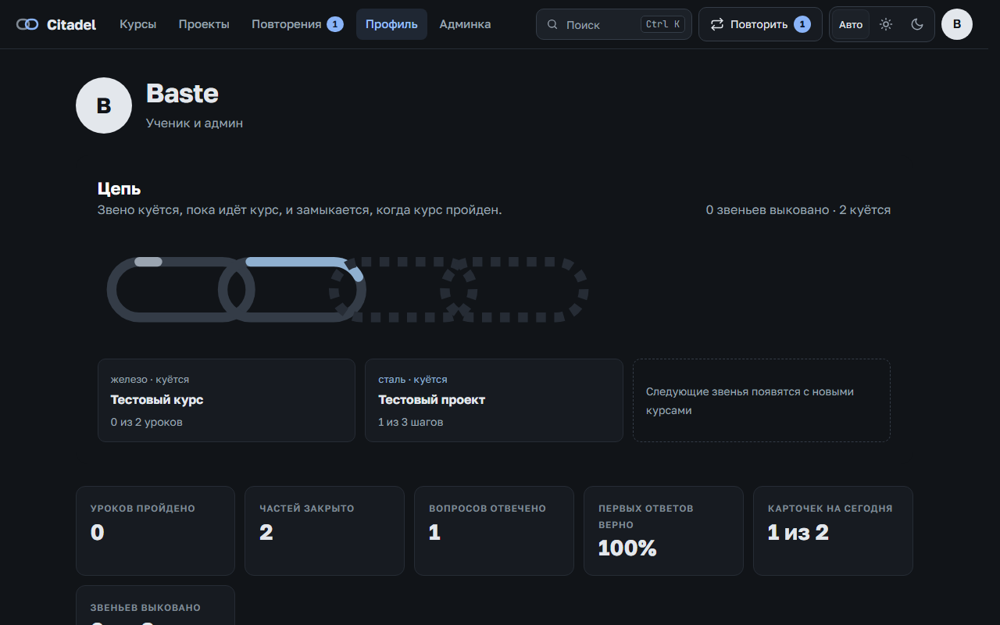
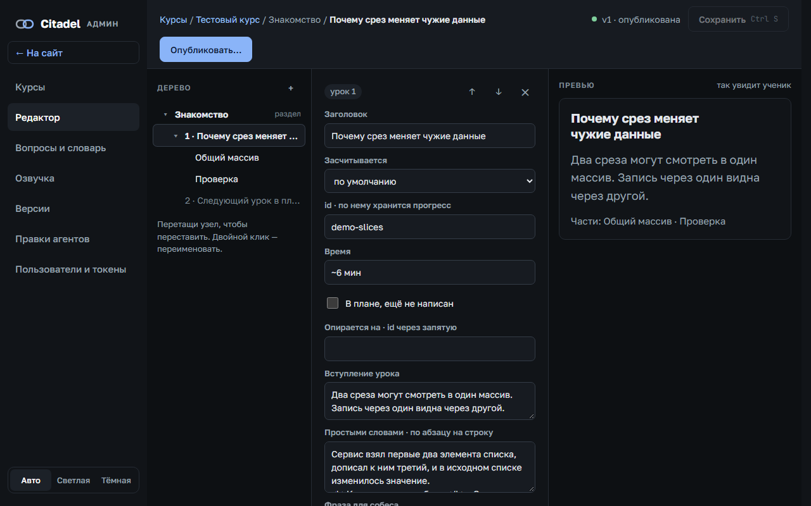

<p align="center">
  
</p>

<p align="center">
  
  
  
  
</p>

**Citadel** — платформа учебных курсов, где каждая тема объясняется через «почему». Курс здесь — данные: дерево узлов из блоков. Сайт — движок, который их показывает. Ученик проходит уроки и повторяет пройденное, админ правит курсы в редакторе, ИИ-агенты присылают правки через API.

Название — отсылка к Цитадели мейстеров: за каждую освоенную науку мейстер куёт звено своей цепи. Здесь курс или проект — звено, а цепь в профиле — всё, что ты прошёл.

## Скриншоты

<table>
  <tr>
    <td width="33%" align="center"><a href="docs/assets/screens/catalog.png"></a><br><sub>Главная</sub></td>
    <td width="33%" align="center"><a href="docs/assets/screens/lesson.png"></a><br><sub>Урок: «Предскажи и запусти»</sub></td>
    <td width="33%" align="center"><a href="docs/assets/screens/anim.png"></a><br><sub>Анимация механики</sub></td>
  </tr>
  <tr>
    <td align="center"><a href="docs/assets/screens/player.png"></a><br><sub>Озвучка урока</sub></td>
    <td align="center"><a href="docs/assets/screens/project.png"></a><br><sub>Проект: уровни и шаги</sub></td>
    <td align="center"><a href="docs/assets/screens/step.png"></a><br><sub>Шаг проекта: ТЗ и подсказки</sub></td>
  </tr>
  <tr>
    <td align="center"><a href="docs/assets/screens/review.png"></a><br><sub>Повторения</sub></td>
    <td align="center"><a href="docs/assets/screens/profile.png"></a><br><sub>Профиль и цепь</sub></td>
    <td align="center"><a href="docs/assets/screens/admin.png"></a><br><sub>Редактор курса</sub></td>
  </tr>
</table>

## Что умеет

**Для ученика**

- **Короткие части.** Урок делится на части по 3–4 минуты, и отметку «пройдено» надо заработать ответами на вопросы.
- **«Предскажи и запусти».** Сначала твой прогноз, потом настоящий вывод программы. Каждый вывод в курсе получен запуском на указанной версии инструмента.
- **Анимации.** Механика и «почему» показаны по шагам.
- **Проекты.** Задача как на работе: разбираешься сам и сам пишешь код. Подсказки открываются по одной, а помощи от уровня к уровню становится меньше.
- **Повторения.** Одна очередь карточек на все курсы, интервалы зависят от того, насколько легко ты вспомнил.
- **Озвучка.** Сервис сам записывает части голосом; в плеере есть главы, перемотка и скорость.
- **Работа без сети.** Прогресс хранится в браузере и на сервере и синхронизируется при подключении.

**Для автора и админа**

- **Редактор** с предпросмотром, версии и публикация, разница между версиями.
- **Правки ИИ-агентов.** Агент подключается по API или MCP, но сам ничего не публикует: правка попадает в очередь, принимает её админ.
- **Запуск кода курсов** в одноразовых контейнерах без сети, с лимитами на ресурсы.
- **Публичные и приватные курсы**, выдача доступа пользователям, поиск по всем курсам.

## Тестовый курс

В репозитории и образе есть только небольшой [тестовый курс и тестовый проект](content-demo/): на них сняты скриншоты, и с ними сервис сразу есть что посмотреть. Свои курсы загружаются в админке или лежат в папке `content/`, которая не попадает в git.

Платформа в работе, план и этапы — в [ROADMAP](docs/dev/ROADMAP.md).

## Быстрый старт

Нужны Go 1.27 и [Task](https://taskfile.dev), для запуска в контейнерах — Docker Desktop. Скопируй `.env.example` в `.env` и впиши код доступа. Готовый образ лежит в `ghcr.io/bastearima/citadel`.

```bash
go install github.com/go-task/task/v3/cmd/task@latest
```

```bash
task run
```

Сервер откроется на http://localhost:8081, база будет лежать в `./data`.

```bash
task up
```

То же в Docker на http://localhost:8080, с исполнителем кода курсов, база в томе.

```bash
task verify
```

Проверка перед отдачей: формат, `go vet`, тесты и проверка курсов. Ещё есть `task backup`: бэкап базы из контейнера в `./backups`.

Как поднять у себя с доменом, включить озвучку и подключить агента — в [гайде по установке](docs/guides/self-hosting.md).

## Как устроено

- **Один бинарник на Go**, фронтенд встроен в него: ES-модули без сборщика.
- **SQLite** хранит версии курсов, пользователей, прогресс и записи озвучки.
- **Курс — JSON** с типизированными блоками. Новый тип блока — новый модуль, а неизвестный тип показывается заглушкой и не ломает страницу.
- **Проект — тот же формат**, поэтому версии, редактор, агенты, доступ и прогресс у него общие с курсами.

## Документы

- [AGENTS.md](AGENTS.md) — с чего начать людям и ИИ-агентам, которые работают с кодом
- [Архитектура](docs/dev/ARCHITECTURE.md) и [принятые решения](docs/dev/decisions/)
- [Формат курсов](docs/dev/CONTENT-FORMAT.md)
- [Как написать хороший урок](docs/guides/authoring.md)
